# Pulse

Self-hosted uptime and incident monitoring. Pulse checks your services from the outside the way a user would, opens one incident per outage, alerts your team, and closes the incident when the service recovers.

**Zero npm dependencies.** It needs Node ≥ 22.5 (it uses the built-in `node:sqlite`), the dashboard is a vanilla-JS SPA, and there is no build step. Clone it and run `npm start`.

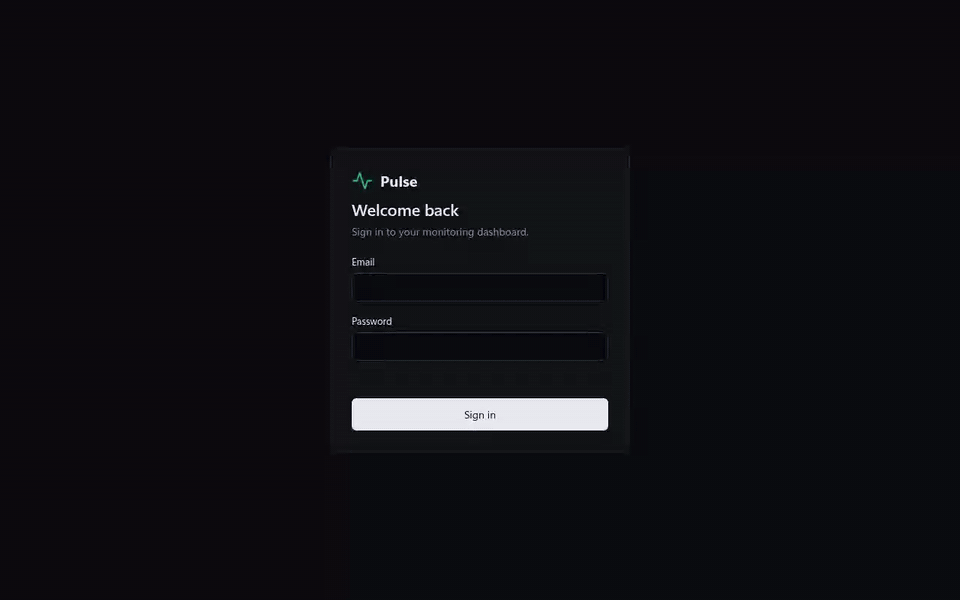

## Where Pulse sits in a system

Pulse is **not** in the request path. Real traffic never passes through it. It runs beside your system and probes it from the outside, so a Pulse outage can never take your product down. A single HTTP probe goes through DNS, TLS, the load balancer and an app server, just like a real request, so it tests the whole path.

```
                 ┌──────────── your system ────────────┐
 users ───────►  DNS ─► Load balancer ─► app servers ─► Postgres / Redis
                 ▲            ▲                ▲              ▲
                 │            │                │              │
                 └────────────┴── probes ──────┴──────────────┘
                                    │
                              ┌─────┴─────┐      alerts
   cron jobs ── heartbeat ──► │   Pulse   │ ───────────► Slack / email / pager
                              └───────────┘
                     (separate box, ideally separate region/provider)
```

| | Load balancer health check | Pulse |
|---|---|---|
| Who asks | The LB, on the internal network | An outside observer |
| What it checks | One instance (`/healthz` on server 3) | The whole path to the public URL |
| What it does on failure | Stops routing to that instance | Opens an incident and alerts a person |

You want both. The load balancer quietly routes around one bad server. Pulse catches what the load balancer can't fix: broken DNS, an expired certificate, the load balancer itself, or every server failing at once. Heartbeats run the other way: a cron job calls Pulse when it finishes, and silence is treated as failure.

Run Pulse on a different host, and ideally a different region or provider, from what it watches. Add a second instance inside the private network if you need TCP checks against private hosts like `db.internal`.

## An outage, end to end

Recorded against a real local service. The service was switched to return `503`, and Pulse detected it, opened an incident, delivered a webhook alert, and resolved the incident on recovery. Nothing in the GIF is mocked. The GIF plays at 2× speed.

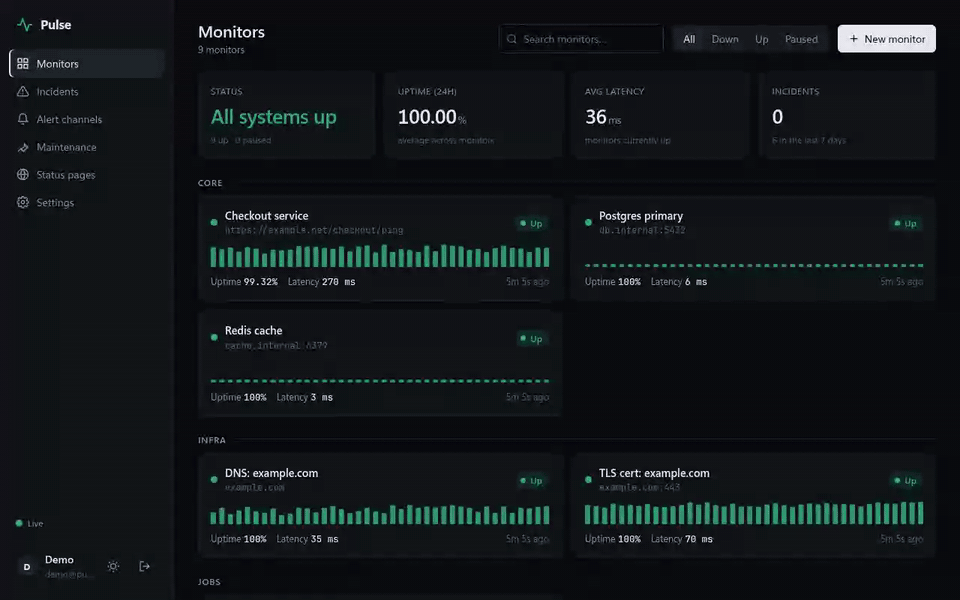

| Incident timeline | Alert delivery log |
|---|---|
| 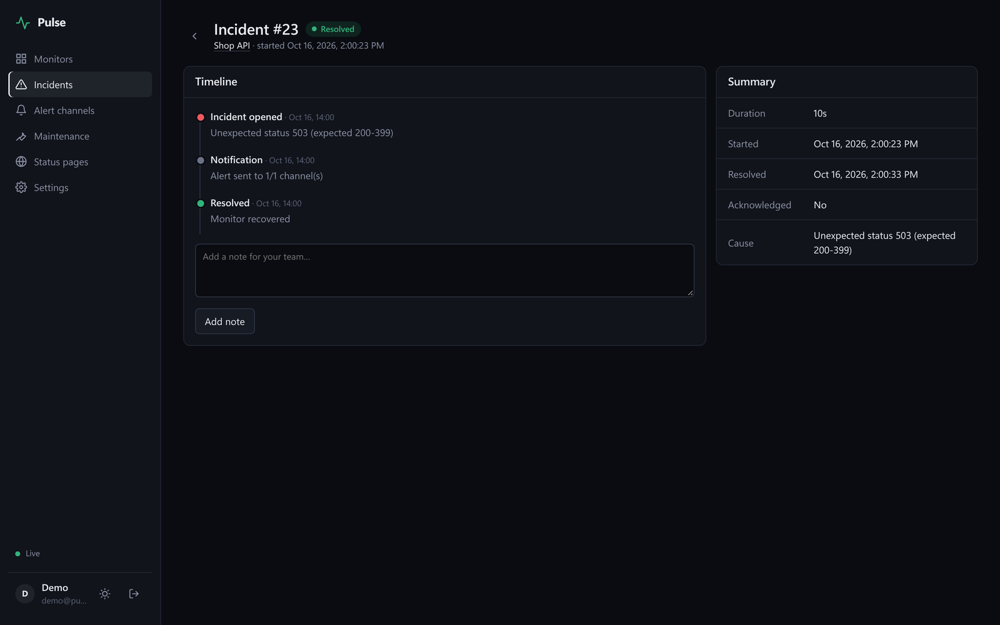 | 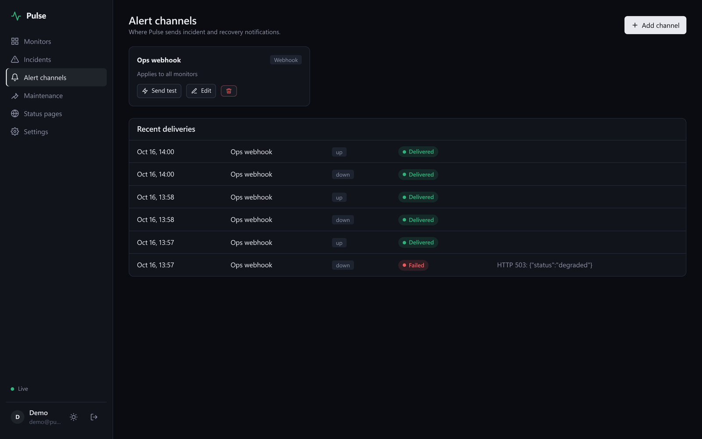 |

The delivery log shows one `Failed` row. On the first run the webhook pointed at the same service that was down, so the delivery got a 503, and Pulse logged it instead of hiding it.

## Adding a monitor

The form shows only the fields for the check type you pick. **Test configuration** runs the check once before you save. The monitor below asserts a JSON field (`status == ok`) and starts checking every 10 seconds.

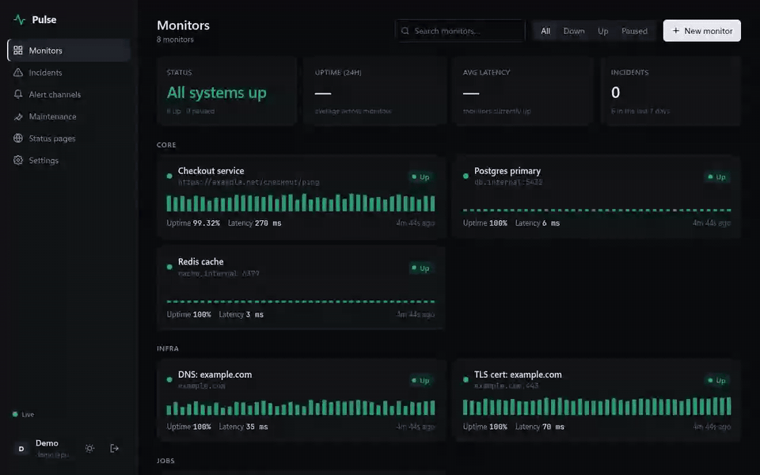

## Features

- **Checks:** HTTP(S) (status ranges, keyword present/absent, JSON path, latency budget, redirects, phase timings, cert expiry), TCP with optional banner, DNS records, TLS expiry, ICMP ping, and cron **heartbeats** (dead-man's switch).
- **Incident engine:** consecutive-failure threshold so one blip never pages you, one incident per outage, acknowledge, timeline with notes, automatic recovery, and maintenance windows that suppress alerts and are excluded from uptime.
- **Alerts:** Slack, Discord, Telegram, ntfy, HMAC-signed webhooks, and a built-in SMTP client, all with retry and a delivery log.
- **Dashboard:** live updates over SSE, latency charts with p50/p95/p99, 90-day uptime strips, dark and light themes, and a mobile layout.
- **Public status pages** with announcements, plus embeddable SVG badges (`/badge/:id/status.svg`, `/badge/:id/uptime.svg`).
- **Ops:** API tokens (with read-only scope), JSON export/import, retention with hourly rollups, login rate limiting, CSRF protection, and a strict CSP.

## Screenshots

| Dashboard (dark) | Dashboard (light) |
|---|---|
| 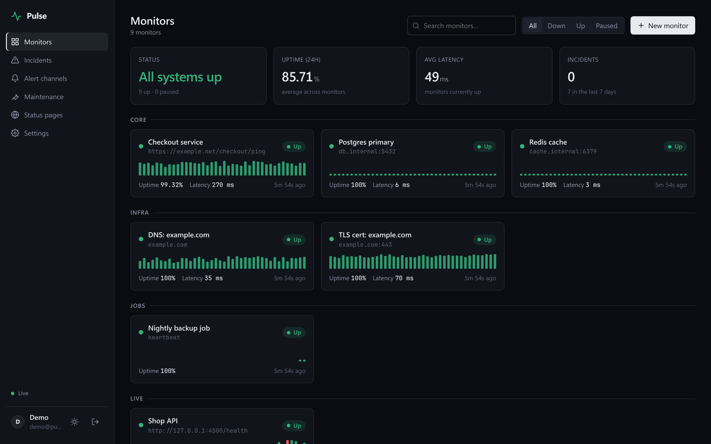 | 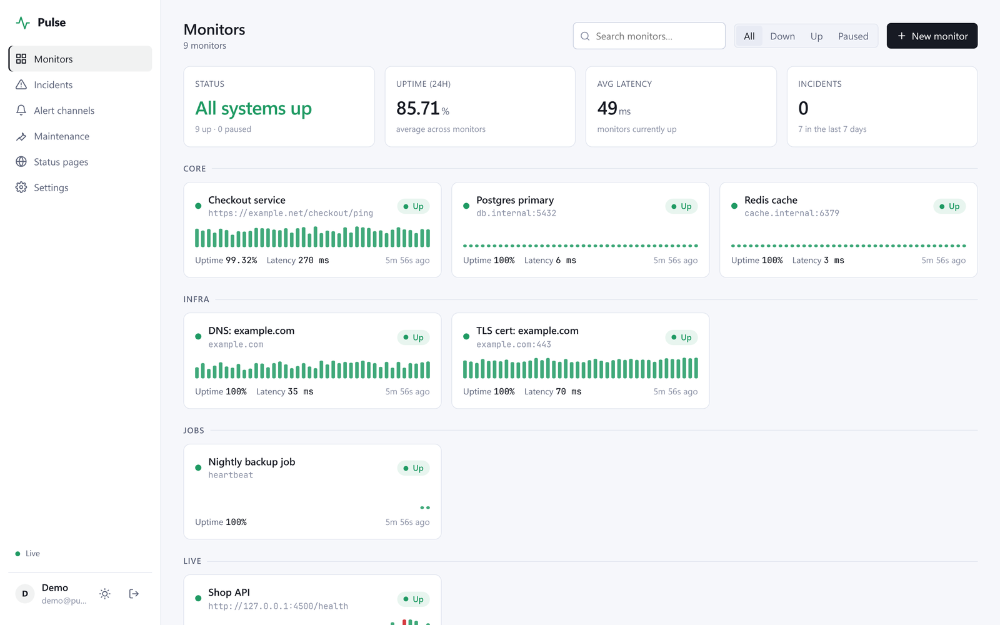 |

| Monitor detail (30 days of history) | Public status page |
|---|---|
| 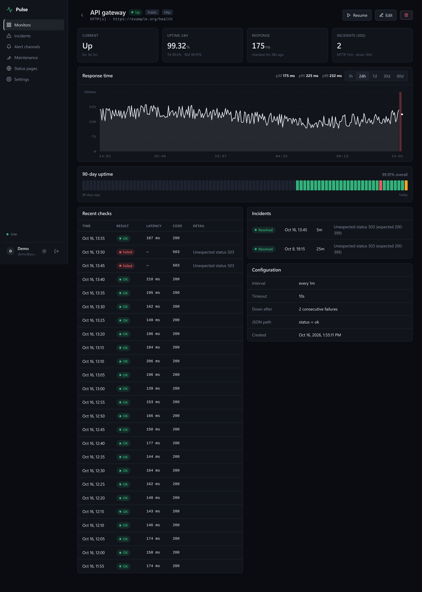 | 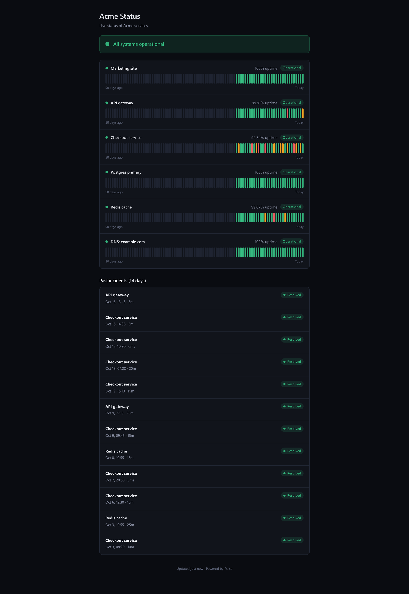 |

| Incidents | New monitor | Mobile |
|---|---|---|
| 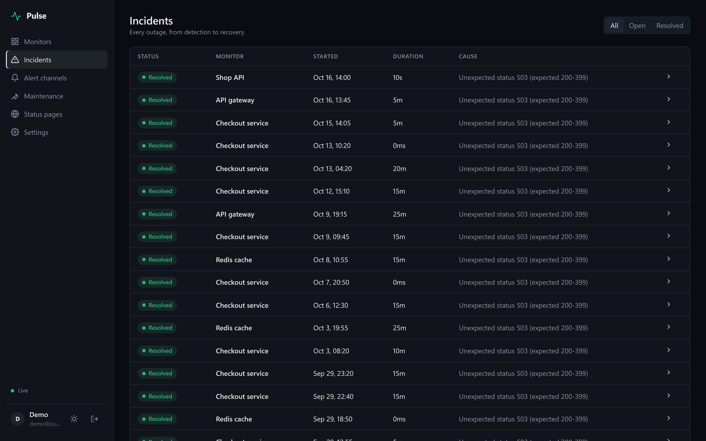 | 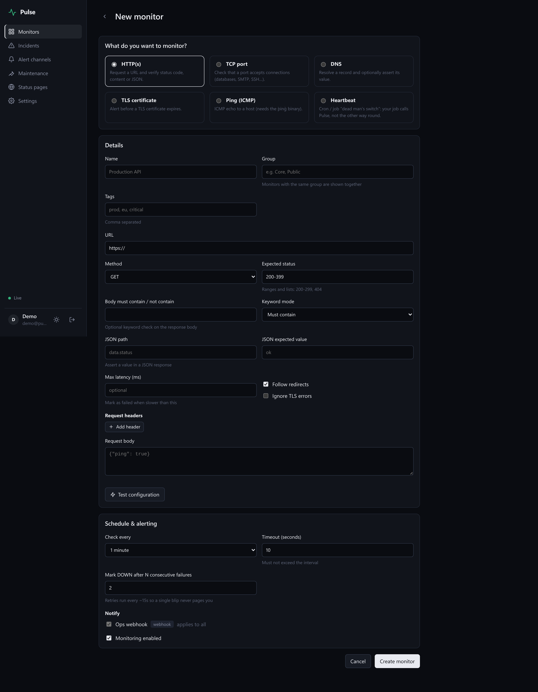 | 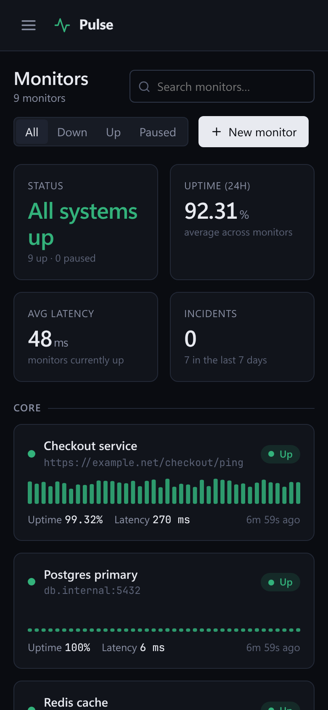 |

More: [live monitor](docs/media/live-monitor.png) · [status page (light)](docs/media/status-page-light.png)

## Run

```sh
npm start                 # http://127.0.0.1:4400; the first visit creates the admin account
node bin/pulse.js seed    # optional demo data (login demo@pulse.local / pulse-demo-1)
npm test                  # node:test suites
docker compose up -d      # or run it in a container on :4400
```

The demo seed creates eight sample monitors with 30 days of synthetic history. They are created with checking disabled, so they never actually probe `example.com` or the made-up internal hosts. Add your own monitors to see live checks.

CLI:

```sh
node bin/pulse.js create-user --email you@example.com --password '********'   # also resets a password
node bin/pulse.js sweep                                                       # run the retention sweep once
```

Environment variables: `PORT`, `HOST`, `PULSE_DATA`, `PULSE_BASE_URL`, `PULSE_COOKIE_SECURE`, `PULSE_TRUST_PROXY`, `PULSE_RAW_RETENTION_DAYS`, `PULSE_ROLLUP_RETENTION_DAYS`.

Heartbeat a cron job:

```sh
0 2 * * *  /usr/local/bin/backup.sh && curl -fsS http://pulse.internal:4400/api/push/<token>
```

## Tests

```
$ npm test
ℹ tests 49
ℹ pass 49
ℹ fail 0
ℹ duration_ms 1747
```

The suites cover the check implementations, the incident state machine, input validation, and the HTTP API, using Node's built-in `node:test`.

## Layout

```
bin/       CLI entry (serve, seed, create-user, sweep)
server/    app.js (composition root), pipeline.js (state machine), scheduler.js,
           models.js, stats.js, retention.js, auth.js, http.js
  checks/     http, tcp, dns, tls, ping
  notifiers/  webhook, chat (Slack/Discord/Telegram/ntfy), email (SMTP)
  routes/     auth, monitors, incidents, channels, misc
web/       SPA: index.html, status.html, css/, js/lib (router, store, charts), js/views
test/      node:test suites
docs/      README media
```

## Design notes

The interface keeps its chrome neutral and uses color only for status: green up, red down, amber pending, blue maintenance. On a monitoring dashboard, any color that isn't status competes with the signal you're scanning for. Text uses the system font stack, so nothing loads from a third party and the strict CSP stays intact. Numbers render in monospace with tabular figures so latency and uptime values line up.

## License

MIT
